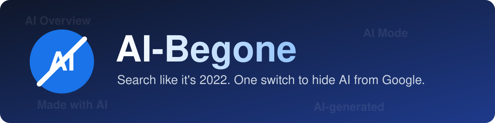
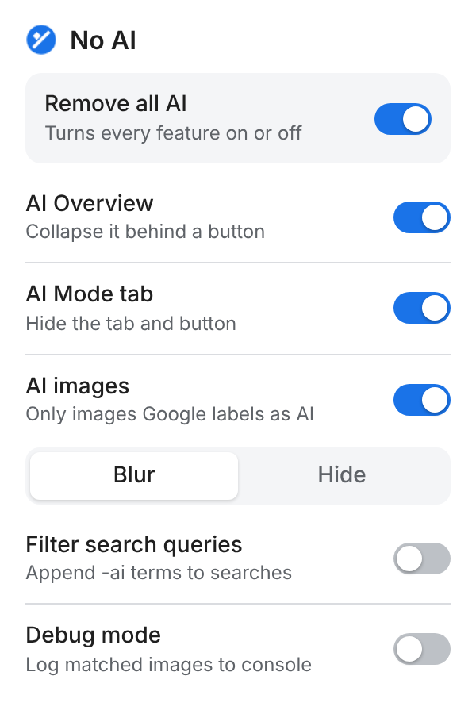
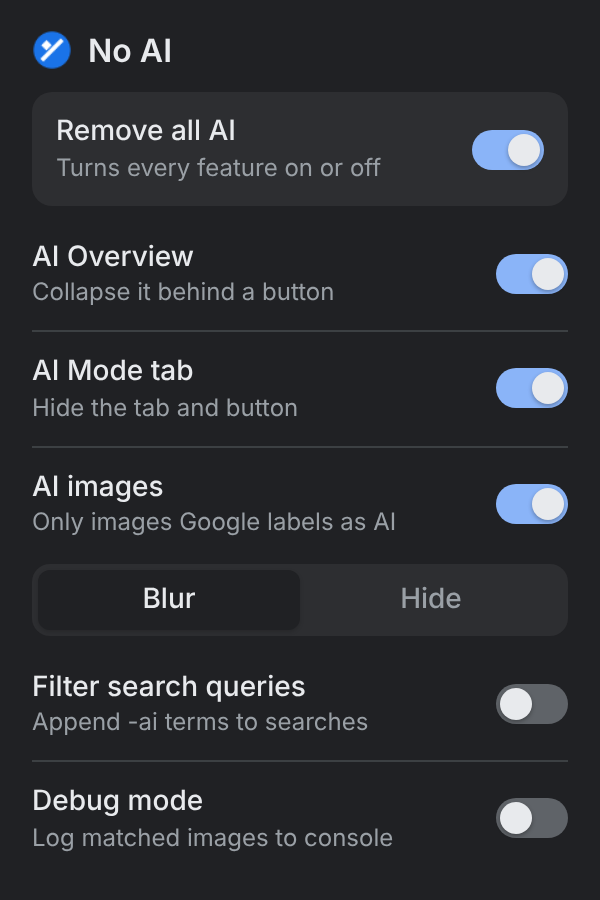

<p align="center">
  
</p>

<p align="center">
  
  
  
  
  
  
</p>

<p align="center">
  <b>A lightweight browser extension that takes the AI out of Google Search.</b><br>
  Collapse the AI Overview, hide the AI Mode tab, and blur or hide AI-generated images, all from one tidy popup.
</p>

---

## ✨ Features

| | Feature | What it does |
|---|---|---|
| 🧹 | **AI Overview** | Collapses Google's AI Overview behind a *Show AI Overview* button. Peek once and it stays hidden next time. |
| 🚫 | **AI Mode tab** | Removes the AI Mode tab and button from the results page. |
| 🖼️ | **AI images** | On Google Images, **blurs** or **hides** pictures that Google itself labels as AI-generated. |
| 🔍 | **Filter search queries** | Optionally appends `-ai` terms to your searches to push AI content further down. |
| 🎛️ | **Master switch** | *Remove all AI* turns everything on or off without forgetting your individual choices. |
| ⚡ | **Instant & synced** | Changes apply to open tabs straight away and sync across your signed-in browsers. |
| 🌍 | **Every Google domain** | Works on google.com, google.co.uk and every country domain. |

## 📸 Popup

<p align="center">
  
  &nbsp;&nbsp;
  
</p>

<p align="center"><sub>Follows your system's light and dark mode.</sub></p>

## 🚀 Install

### Chrome / Edge / Brave

1. Clone or [download this repo](../../archive/refs/heads/main.zip) and unzip it.
2. Open `chrome://extensions` (or `edge://extensions`) and switch on **Developer mode**.
3. Click **Load unpacked** and pick the folder containing `manifest.json`.
4. Pin **No AI** from the puzzle-piece menu and you're done.

### Safari (macOS & iOS)

1. Open `safari/No AI.xcodeproj` in Xcode.
2. Pick the **macOS** or **iOS** scheme and hit **Run**.
3. Turn on the extension in **Safari → Settings → Extensions** (or **Settings → Safari → Extensions** on iPhone).

> [!NOTE]
> Google still generates the AI Overview on its servers. AI-Begone hides it in your browser; it doesn't change your results.

## 🔒 Privacy

AI-Begone collects **nothing**.

- No analytics, tracking or telemetry
- No network requests and no remote code; everything ships in the package
- Only two permissions: `storage` (your settings) and Google Search pages
- Settings live in `chrome.storage.sync`, synced only between your own browsers

## 🧠 How it works

```
document_start  →  CSS flash guard hides known AI containers before paint
       ↓
apply.js        →  reads settings, writes state onto <html data-noai-*>
       ↓
observer.js     →  one MutationObserver, batched per animation frame
       ↓
rules.js        →  positively identifies AI elements and marks them
       ↓
styles.css      →  hides / blurs only what's marked, only while enabled
```

It's built to **fail safe**: if Google changes its markup and nothing matches, nothing is hidden. It never touches organic results or ads, and all selectors live in a single config file, so fixing breakage is a one-file change.

## 🗂️ Project structure

```
├── manifest.json            MV3 manifest (host lists generated)
├── src/
│   ├── core/                settings, observer, site registry, entry point
│   ├── platform/browser.js  the only file that touches browser APIs
│   ├── popup/               the settings popup
│   └── sites/google/        selectors, labels, rules and styles for Google
├── scripts/                 domain list generator
├── tests/                   fixtures, checks and manual test plan
└── safari/                  Xcode wrapper for Safari on macOS and iOS
```

## 🧪 Testing

```sh
tests/run.sh               # run everything
node tests/check.js        # config/CSS sync, settings logic, manifest
node tests/run-fixtures.js # fixture tests in headless Chrome
```

## 🛣️ Roadmap

- [x] Google Search: AI Overview & AI Mode
- [x] Google Images: AI-labelled images
- [x] Safari (macOS & iOS)
- [ ] Chrome Web Store release
- [ ] Firefox support
- [ ] More sites (Bing, YouTube and beyond)

## 🛠️ Contributing

Google changes its markup often. If something slips through, please [open an issue](../../issues) with the page and what you saw. The [developer guide](docs/DEVELOPMENT.md) covers updating selectors, adding new sites and porting to other browsers.

---

<p align="center">
  Made by <a href="https://github.com/CaseyTKing">Casey Tarhan-King</a>
</p>
